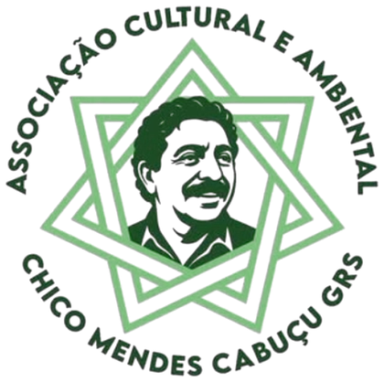

<div align="center">



# Chico Mendes · Cabuçu

**Nova proposta de site para a Associação Cultural e Ambiental Chico Mendes**
Cabuçu · Guarulhos/SP

*“Se você gosta, preserve! Se não gosta, respeite! Pois vidas precisam dela, inclusive a sua!”*

</div>

---

## Sobre o projeto

Este é um projeto **voluntário**, desenvolvido por iniciativa própria de [Matheus Andrell](https://github.com/) para a **Associação Cultural e Ambiental Chico Mendes**. A Associação é uma organização da sociedade civil que, desde 2005, atua no Cabuçu, em Guarulhos (SP), em três frentes:

- 🌱 **Ambiental:** o Viveiro Ecológico Cabuçu, com até 20 mil mudas nativas da Mata Atlântica por safra.
- 🎭 **Cultural:** o Ponto de Cultura Chico Mendes, com oficinas de música, teatro, vídeo, fotografia, HQ e patrimônio histórico.
- 🧒 **Educacional:** a Creche Chico Mendes, que atende 240 crianças de 1 a 3 anos com educação ambiental desde cedo.

O site atual da Associação foi feito em Wix há alguns anos e está desatualizado. A ideia deste projeto é oferecer à ONG um site moderno, rápido e fácil de manter, que:

- valorize o trabalho da Associação e a história do bairro;
- facilite doações, voluntariado e parcerias;
- dê transparência total às contas, com todos os documentos públicos organizados e pesquisáveis;
- funcione bem no celular, seja leve e carregue rápido mesmo com conexão fraca;
- aproxime as pessoas da causa com uma experiência interativa em 3D: a semente que vira floresta e a **Floresta Viva**, onde cada visitante planta a sua árvore nativa.

> Este repositório é uma proposta independente e sem fins lucrativos. O nome, o logotipo, as fotos, os textos institucionais e os documentos da transparência pertencem à Associação Cultural e Ambiental Chico Mendes e foram usados com o objetivo de construir o site para ela.

## Funcionalidades

| | |
|---|---|
| 🌳 **Da semente à floresta** | Animação 3D na página inicial: a semente germina, vira um ipê e depois uma floresta de espécies nativas. As árvores são geradas de forma procedural e o crescimento é calculado na GPU (shader). |
| 🌿 **Floresta Viva** | O visitante escolhe uma espécie nativa (ipê, quaresmeira, cabuçu, jequitibá, araucária ou pau-brasil), coloca seu nome e planta **uma** árvore, que fica salva no navegador. |
| 📂 **Portal da Transparência** | Os 63 documentos públicos (contratos, termos de parceria, relatórios e demonstrações contábeis), com busca e filtros por tipo e por ano. |
| 💚 **Como ajudar** | Dados bancários com botão de copiar e PIX copia e cola com QR Code, gerado automaticamente quando a chave é configurada. Também lista as doações de itens, o voluntariado e as parcerias. |
| 📰 **Blog** | Os informativos da Associação, com a imagem original e o texto transcrito (acessível a leitores de tela). |
| 🗺️ **Contato** | Telefone, e-mail, redes sociais e mapas das duas unidades. |
| 📱 **Responsivo** | Layout pensado primeiro para o celular, com páginas carregadas sob demanda. |

As páginas seguem o mesmo menu e os mesmos endereços do site atual (`/sobrenos`, `/projetos`, `/cabucu`, `/comoajudar`, `/transparencia`, `/blog` e `/contato`). Assim, links antigos continuam funcionando.

## Tecnologias

- [React 18](https://react.dev/) + [React Router 6](https://reactrouter.com/)
- [Vite 5](https://vitejs.dev/)
- [Three.js](https://threejs.org/) com [React Three Fiber](https://docs.pmnd.rs/react-three-fiber) e drei
- CSS Modules, com as fontes Nunito e Nunito Sans
- Deploy na [Vercel](https://vercel.com/)

## Como rodar

```bash
git clone <url-do-repositorio>
cd chico-mendes
npm install
npm run dev        # http://localhost:5173
```

```bash
npm run build      # gera a versão de produção em dist/
npm run preview    # testa a versão de produção localmente
```

**Publicação:** importe o repositório na Vercel. As configurações (build, rotas e cache) já estão no `vercel.json`.

## Arquitetura

O projeto segue **Clean Architecture**. A interface é organizada em **Atomic Design**:

```
src/
├─ domain/            regras de negócio puras (sem React)
│  ├─ tree/           entidade Tree (1 árvore por visitante) + contrato do repositório
│  └─ transparency/   entidade Documento, categorias e formatação
├─ application/       casos de uso
│  ├─ tree/           plantTree, getMyTree
│  ├─ transparency/   filtrar e agrupar documentos
│  └─ content/        leitura do conteúdo do site
├─ infrastructure/    detalhes técnicos substituíveis
│  ├─ storage/        repositório da árvore em localStorage
│  ├─ repositories/   documentos da transparência
│  ├─ payments/       gerador do PIX copia e cola (BR Code)
│  └─ data/           textos, fotos, blog, espécies, transparencia.json
├─ app/               composição (container.js), rotas e menu
└─ presentation/      React
   ├─ components/
   │  ├─ atoms/       Button, Logo, Photo, Icon, Tag, Section…
   │  ├─ molecules/   SectionHeading, ProjectCard, DocumentRow, CopyRow…
   │  ├─ organisms/   SiteHeader, SiteFooter, GrowthStage (3D), FlorestaViva…
   │  └─ templates/   SiteLayout, PageTemplate
   ├─ pages/          uma página por rota, carregada sob demanda
   ├─ hooks/          useMyTree, useCopy, useInView…
   ├─ three/          cenas 3D (árvores procedurais, crescimento no shader)
   └─ styles/         tokens de design
```

As dependências apontam para dentro: `presentation → application → domain`. A `infrastructure` implementa os contratos e é ligada às outras camadas em `app/container.js`. Por exemplo, para guardar as árvores num banco de dados em vez do localStorage, basta criar outro repositório com `get` e `save` e trocar a ligação ali.

## Identidade visual

- **Logo:** o logotipo oficial da Associação, em `public/brand/`.
- **Cores:** tiradas do logotipo e do site atual:
  - verde-escuro `#1b4a26`
  - verde-folha `#72bd7c`
  - sálvia `#81a079`
  - verde-claro `#acd5a1`
  - amarelo `#eade71`
- **Tipografia:** Nunito nos títulos, que é arredondada como as letras do logo, e Nunito Sans nos textos.

## Como manter o conteúdo

Todo o conteúdo fica em `src/infrastructure/data/`. Não é preciso mexer nos componentes.

| O quê | Onde |
|---|---|
| Textos institucionais, projetos, história, doação | `content.js` |
| Fotos | `fotos.json` (lista) + `public/fotos/` (arquivos) |
| Publicações do blog | `blog.js`; a imagem vai em `public/blogs/` |
| Espécies da Floresta Viva | `species.js` |
| Documentos da transparência | PDFs em `public/docs/` + `scripts/organizar-transparencia.py` |

**Nova publicação no blog:** adicione um item em `blog.js` com o próximo `numero`. A lista é exibida a partir do nº 1.

**Novo documento na transparência:**

1. Coloque o PDF em `public/docs/`.
2. Inclua o título que deve aparecer no site na lista do script.
3. Rode `npm run transparencia`. O script renomeia o arquivo e atualiza o índice.

**Fotos do site antigo:** o site da Associação no Wix será descontinuado. Para trazer as fotos para o projeto, rode:

```bash
npm run fotos
```

O script baixa as 32 fotos para `public/fotos/` (WebP ou JPEG, até 1920px) e marca cada uma em `fotos.json`. A partir daí o site usa as cópias locais. Ele pode ser rodado de novo sem problema: pula o que já foi baixado. Enquanto uma foto não estiver baixada, ela continua vindo do Wix.

**PIX:** preencha `DOACAO.pixChave` em `content.js`. O QR Code e o código copia e cola aparecem sozinhos.

## Próximos passos

- [ ] Receber a chave PIX da Associação
- [ ] Floresta Viva compartilhada entre todos os visitantes (com banco de dados)
- [ ] Painel simples para a equipe da ONG publicar no blog sem mexer em código
- [ ] Domínio próprio, se a Associação adotar o novo site

## Contribuindo

Sugestões, correções e ideias são muito bem-vindas. Abra uma *issue* ou envie um *pull request*. Se você faz parte da Associação ou conhece o trabalho no Cabuçu, sua opinião é especialmente importante.

## Contato da Associação

**Associação Cultural e Ambiental Chico Mendes** · CNPJ 07.402.743/0001-37
📞 (11) 2407-9620 · ✉️ chicomendescabucu@gmail.com
📍 Rua Hans Heitel Hohl, 58 · Chácaras Cabuçu · Guarulhos/SP
[Instagram](https://www.instagram.com/cabucuchicomendes/) · [Facebook](https://www.facebook.com/chicomendes.cabucu/)

---

<div align="center">
Feito com 💚 de forma voluntária por <strong>Matheus Andrell</strong>, para quem cuida do Cabuçu.
</div>
